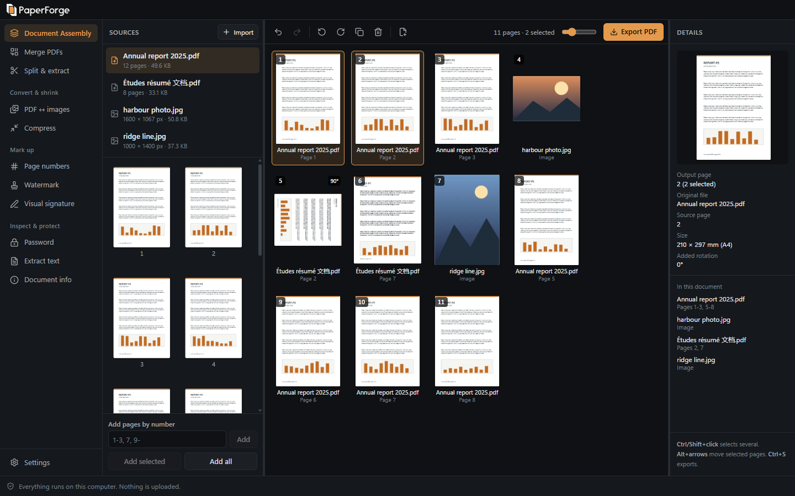
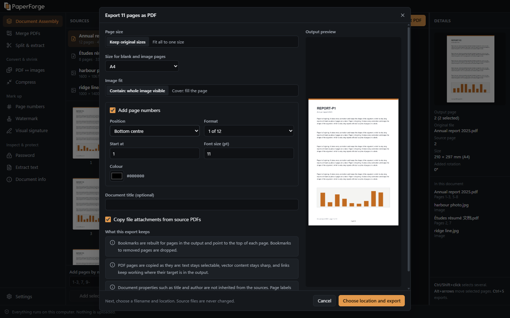
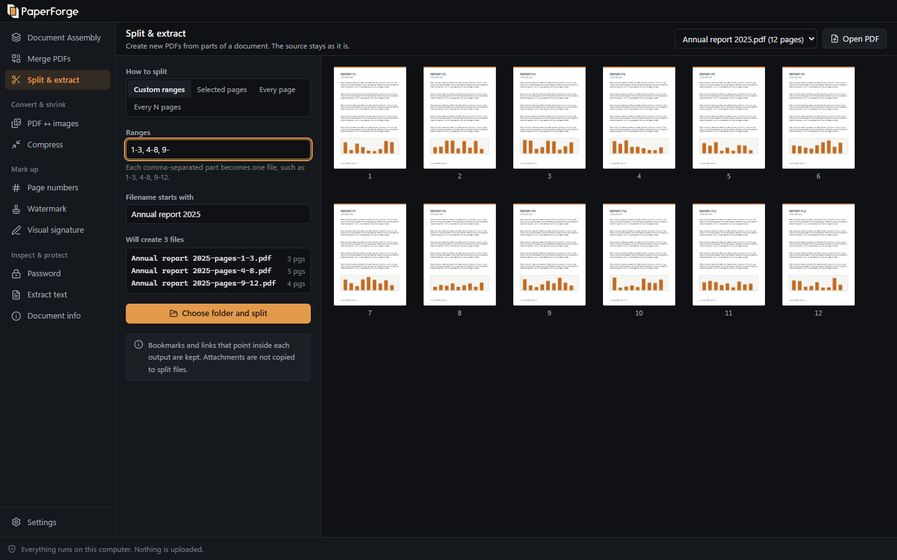
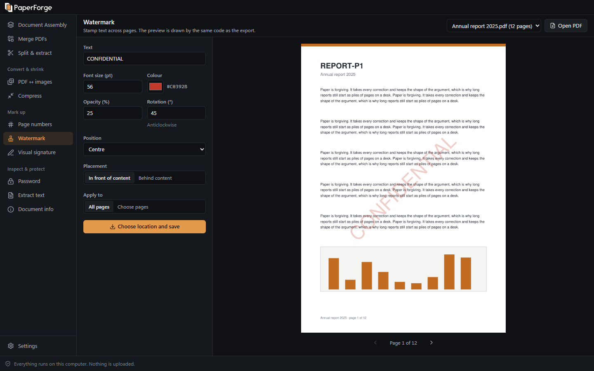
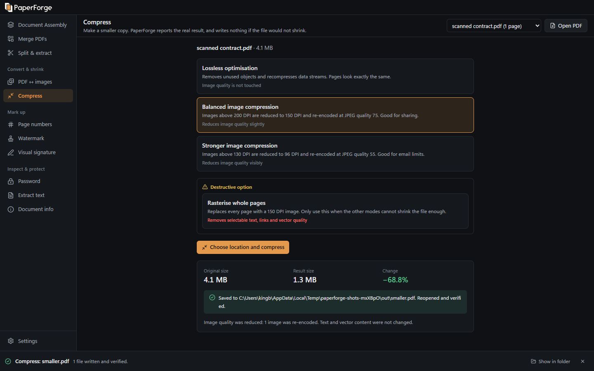
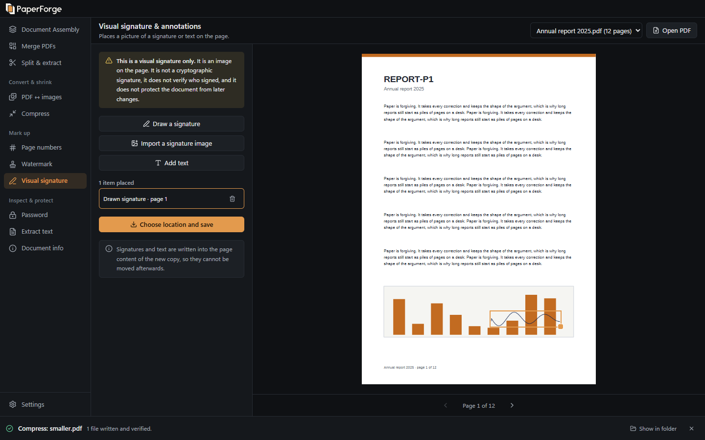
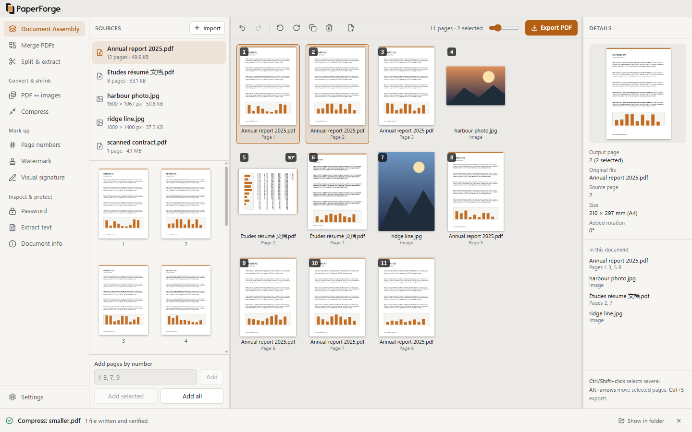

<h1>
  <picture>
    <source media="(prefers-color-scheme: dark)" srcset="branding/logo/horizontal/paperforge-horizontal-on-dark.svg">
    
  </picture>
</h1>

A desktop PDF toolkit for Windows that works entirely on your computer. There are no accounts, subscriptions, ads, analytics or uploads, and it makes no network requests while you work.

Its main feature is **Document Assembly**: drop in PDFs and images, see every page as a thumbnail, pick the pages you want from any file, arrange them, and export one new PDF. Your original files are never changed.



## Document Assembly

Import two PDFs and three images. Take pages 1-3 from the first PDF and page 7 from the second, put the images between them, rotate one page, add page numbers, and export.

- Import with the file picker, Ctrl+O, or by dropping files anywhere in the window
- Add pages one at a time, by selection, by typed range (`1-3, 7, 9-`) or all at once
- Drag to reorder, including groups, which keep their internal order
- Select with click, Ctrl+click, Shift+click and Ctrl+A
- Rotate, duplicate and remove pages, and insert blank ones
- Undo and redo every edit
- Each page shows its original file and page number
- Long documents stay fast: page lists are virtualised and thumbnails are drawn on demand

Every page in the output is its own instance with a stable ID, so two copies of one source page can be rotated and moved independently. Nothing touches a file until you export, and each export is reopened and checked before it replaces anything.



The export dialog sets page size handling, blank page size, image fit and page numbers. It also says what the export will keep for your specific files. The preview comes from the real export code running on one page.

## Other tools

| Tool | What it does |
|---|---|
| **Merge PDFs** | Reorder files, limit any file to a page range, preview the output order. Runs on the Assembly engine. |
| **Split & extract** | Selected pages, every page, custom ranges (`1-3, 4-8, 9-12`) or every N pages. Shows the expected filenames first. All-or-nothing output. |
| **Compress** | Lossless, balanced or stronger image compression, with an honestly labelled whole-page rasterise option. Reports real sizes, and writes nothing if the file would not shrink. |
| **PDF ↔ images** | Pages to PNG or JPG at a chosen DPI. Images to PDF with page size, orientation, margins, and contain or cover. |
| **Page numbers** | Six positions, start number, font size, colour, page ranges, and formats like `1`, `Page 1`, `1 of 12`. Live preview. |
| **Watermark** | Text, size, colour, opacity, rotation, position, page selection, in front of or behind content. Live preview. |
| **Visual signature** | Draw or import a signature, place and resize it, add text. This is a picture on the page and is not a cryptographic signature, and the app says so. |
| **Password** | AES-256 encryption with an open password and optional permissions. Removes encryption when the supplied password authorises it. |
| **Extract text** | Preview, copy, or save as UTF-8 text, with page separators. Names pages with no extractable text. |
| **Document info** | File facts, page sizes, encryption status and metadata. Edit or remove properties in a new copy. |

| | |
|---|---|
|  |  |
|  |  |

Light theme:



## Install

Download a build from the project's Releases page if one is published, or build it yourself as described below.

- `PaperForge-Setup-<version>.exe` installs per user and does not need administrator rights.
- `PaperForge-Portable-<version>.exe` runs without installing.

Python is not needed to run PaperForge: the worker ships inside the app.

> Builds are **not code-signed**, so Windows SmartScreen may warn about an unknown publisher. Choose *More info*, then *Run anyway*, if you trust where the file came from.

## Develop

You need Node.js 22.13 or newer and Python 3.11 or newer (developed on Node 24 and Python 3.12).

```bash
npm install
```

```bash
npm run setup
```

| Command | What it does |
|---|---|
| `npm run dev` | Runs the app with hot reload |
| `npm test` | Runs unit, worker and end-to-end tests |
| `npm run build` | Type-checks, lints, then builds the installer and portable app into `release/` |

Other useful commands:

| Command | What it does |
|---|---|
| `npm run typecheck`, `npm run lint` | Static checks for TypeScript and Python |
| `npm run test:unit`, `npm run test:worker`, `npm run test:e2e` | One test layer at a time |
| `npm run test:packaged` | Smoke-tests `release/win-unpacked/PaperForge.exe` |
| `npm run notices` | Regenerates `THIRD_PARTY_NOTICES.md` from installed packages |
| `npm run screenshots` | Recaptures the README images from the running app |

Set `PAPERFORGE_DEBUG=1` to see worker logs from a packaged build. Logs hold operation names, job IDs, timings and error codes. They never hold document text, file contents or passwords.

## Architecture

```
┌─ Renderer (React, sandboxed) ──────────────┐
│  Document workspace, tools, pdf.js previews│   holds opaque file ids, never paths
└───────────────┬────────────────────────────┘
                │ narrow preload API, every payload validated with Zod
┌───────────────▼────────────────────────────┐
│  Main process (Electron)                   │   native dialogs, file allow-list, private
│  registry · job lanes · protocols · CSP    │   URL schemes, resolves ids to paths
└───────────────┬────────────────────────────┘
                │ JSON Lines over stdin/stdout, logs on stderr
┌───────────────▼────────────────────────────┐
│  Python worker (PyMuPDF, Pillow)           │   validates again, does all PDF work,
│  two processes: jobs and interactive       │   frozen with PyInstaller when packaged
└────────────────────────────────────────────┘
```

```
src/shared/     Schemas, assembly model, page ranges, split planning, preservation report
src/main/       Window, IPC, file registry, worker host, protocols, security, settings
src/preload/    The renderer's entire view of the system
src/renderer/   React UI: components, stores, pdf.js engine, one file per tool
worker/         Python engine: assembly, stamps, operations, protocol, tests
e2e/            Playwright tests that drive the built Electron app
tests/          Unit tests and protocol fixtures shared by Zod and Python
scripts/        Setup, freezing, fixtures, notices, screenshots
```

**Why two worker processes?** Long exports run in the jobs process, while previews and file inspection use the interactive one, so a big export does not freeze the preview. Each process handles one job at a time from a bounded queue.

**Why does the renderer never see a path in a request?** A source exists because you picked or dropped it. An output exists because you chose it in a native dialog, and that token works once. The renderer only holds IDs, so even a compromised renderer cannot ask for an arbitrary file.

**Previews.** Thumbnails and readable previews use pdf.js, reading byte ranges on demand through a private `pfdoc://` scheme, with a bounded cache and render queue. Previews of *changes* (page numbers, watermarks, layouts) come from the worker running the same code as the export, so they match the output.

**Cancellation.** Cancel asks the worker to stop at its next safe point. If it does not stop within five seconds, for example inside a long native call, the process is terminated, its temp files are removed, and it restarts on the next job. A job shows as cancelled only once one of those has actually happened.

**Output safety.** Outputs are written as temp files beside the destination, reopened and checked for page count, dimensions and rotation, then moved into place. Multi-file jobs commit together and roll back on failure. Sources cannot be chosen as outputs.

### Security

- Node integration off, context isolation on, renderer sandboxed
- Strict content security policy with no remote code
- All navigation and new windows blocked, and permission requests denied
- External links come from a fixed list: the renderer names a link and cannot supply a URL
- Subprocesses are started with argument arrays and no shell
- Passwords stay in memory, travel only over the worker's stdin, and are never logged or saved
- Recent files are off by default, and clearing them is one click in Settings

## How document features are handled

| Feature | Keep original sizes | Fit to one size | Whole-document tools (numbers, watermark, signature, metadata, compress) |
|---|---|---|---|
| Text, vector graphics | Kept as is | Kept, scaled as vector | Kept |
| Page rotation, crop and media boxes | Kept | Content shown as seen, on the new size | Kept. Stamps land where the page shows them |
| External links | Kept | Kept, repositioned | Kept |
| Internal links | Kept if the target is in the output. Others removed, with a count | Same | Kept |
| Bookmarks | Rebuilt for pages in the output, pointing to the top of the page | Same | Kept |
| Annotations | Kept | Flattened into the page | Kept |
| Form fields | Kept editable. Duplicates are renamed so they stay independent | Flattened, values stay visible | Kept |
| XFA forms | Not carried over, with a warning | Not carried over, with a warning | Kept in the file |
| File attachments | Copied (optional) | Copied (optional) | Kept |
| Digital signatures | **Invalidated.** You must acknowledge a warning first | Same | Same |
| Document scripts, open actions | Not copied | Not copied | Kept |
| Optional content layers | Warning shown, check visibility | Warning shown | Kept |
| Metadata | Not inherited, title can be set | Same | Kept or edited |
| Encryption | Output is not encrypted, with a warning | Same | Kept. Rasterise removes it, with a warning |

The export dialog and the tools show these as specific statements about your files before you commit.

**Permissions are respected.** If a PDF's permission flags forbid an action and you only have the open password, PaperForge refuses and explains why. Entering the owner password lifts the restriction. There is no password cracking or bypass.

**Compression** uses MuPDF's image rewriter, which handles masks, transparency and shared images. The tests check that transparency survives recompression and that text stays selectable.

## Known limitations

- Windows only for now. The code is mostly portable, but other platforms are not packaged or tested.
- No OCR. Scanned pages have no extractable text, and the Extract text tool says so.
- No redaction. Drawing a black box is not secure redaction, so it is not offered.
- Page numbers and watermarks use Helvetica for Latin text and an embedded fallback font for Greek, Cyrillic and CJK. Right-to-left scripts are refused with an explanation, not replaced with wrong characters.
- Bookmarks rebuilt by assembly point to the top of a page, not to a position within it.
- Page labels are not carried into assembled documents.
- Fit mode rotates pages to suit their content, not to a fixed orientation.
- Installers are not code-signed.
- Merging very large documents is limited by available memory, because the output is built in memory before it is written.
- Assembling pages from a very long PDF that contains form fields is much slower than from one without, because form handling rescans the source for each page.

## Testing

`npm test` runs three layers:

- **Unit tests (Vitest):** page ranges, the assembly model with undo and redo, split planning, schemas, the preservation report, and the worker host against a fake worker that crashes, hangs and emits garbage.
- **Worker tests (pytest):** export ordering, mixed sizes and rotations, crop boxes, links, bookmarks, forms, attachments, split naming, collisions, atomic output, locked files, disk-full handling, passwords and permissions, compression honesty, and rendered pixel checks of stamp and signature placement on rotated and cropped pages. Protocol tests drive the real worker process.
- **End-to-end tests (Playwright):** the main journey and every tool, driven through the built Electron app, with exported files reopened by a separate script. Native dialogs are answered from the test. Fixtures are synthetic PDFs with visible page labels, generated at run time.

The same fixture set in `tests/protocol-fixtures` is checked by both Zod and the Python validator, so the two cannot drift.

## Licence

PaperForge is licensed under the **GNU Affero General Public License v3.0 or later**. See [LICENSE](LICENSE).

This is not an arbitrary choice. PaperForge bundles PyMuPDF and MuPDF, which are available under the AGPL or a commercial licence from Artifex, and AGPL is the option that fits a free, open-source app. If you distribute PaperForge or a modified version, you must offer its complete source under the same licence. A closed-source fork would need a commercial licence from [Artifex](https://artifex.com/licensing).

## Dependency notices

| Component | Licence | Role |
|---|---|---|
| [PyMuPDF](https://github.com/pymupdf/PyMuPDF) / MuPDF | AGPL-3.0 or Artifex commercial | PDF processing |
| [Pillow](https://python-pillow.github.io/) | MIT-CMU | Image processing |
| [pdf.js](https://mozilla.github.io/pdf.js/) | Apache-2.0 | Previews and thumbnails |
| [Electron](https://www.electronjs.org/) | MIT (includes Chromium and Node.js) | Desktop shell |
| React, Zustand, Zod, TanStack Virtual | MIT | User interface |
| Lucide | ISC | Icons |
| [PyInstaller](https://pyinstaller.org/) | GPL-2.0-or-later with a bootloader exception | Freezes the worker |

Full texts are in [THIRD_PARTY_NOTICES.md](THIRD_PARTY_NOTICES.md), which is also available in the app under Settings.

PyMuPDF 2.1 declares dependencies on its layout and LLM add-ons, including onnxruntime and numpy. PaperForge uses none of them, so `worker/requirements.lock` leaves them out and installs with `--no-deps`. The worker test suite runs against exactly that set.

## Roadmap

- Saved assembly projects
- Local OCR through an optional Tesseract install
- Bookmark editing
- Batch presets
- Visual comparison of two PDFs
- A command-line interface over the same engine
- macOS and Linux builds
