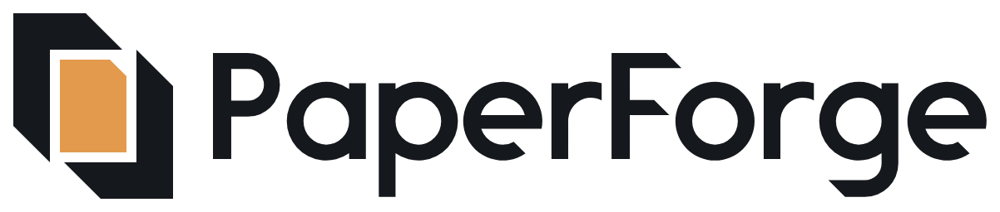

# PaperForge logo guide

## The idea

Two sheets interlock around a new page, the hot spot where they fuse. It draws Document Assembly as forge-welding: separate documents go in and one new document comes out.

## Which file to use

| Need | File |
|---|---|
| Light background | `logo/horizontal/paperforge-horizontal-color.svg` |
| Dark background | `logo/horizontal/paperforge-horizontal-on-dark.svg` |
| Square or tall space | `logo/stacked/paperforge-stacked-color.svg` or `-on-dark.svg` |
| Symbol alone | `logo/symbol/paperforge-symbol-color.svg` or `-on-dark.svg` |
| Symbol at 32 px or smaller | `logo/symbol-small/paperforge-symbol-small-*.svg` |
| Name alone | `logo/wordmark/paperforge-wordmark-*.svg` |
| One colour only | The `-black`, `-white` or `-ember` version of any of the above |
| Windows app icon | `icons/windows/icon.ico` and `icons/windows/icon.png` |
| Website or web app icons | `icons/web/`, including `head-snippet.html` |
| Places that can't use SVG | `logo/png/` (transparent background) |

## The three colour rules

1. **Full colour:** the sheets are Anvil on light backgrounds and Sheet on dark ones. The centre page is always Ember.
2. **One colour:** the centre page is removed, leaving the sheets around an empty space. Don't draw the page in the same colour as the sheets, because it turns to mud at small sizes.
3. **Ember alone on a light background:** use Ember Deep. Ember is only 2.3:1 against white, so it needs the dark sheets beside it.

## Colour

| Name | HEX | RGB | CMYK (approximate) | Role |
|---|---|---|---|---|
| Ember | `#E39A4D` | 227, 154, 77 | 0, 32, 66, 11 | The centre page and the app's dark-theme accent |
| Ember Deep | `#B35F14` | 179, 95, 20 | 0, 47, 89, 30 | One-colour logo on light backgrounds and the app's light-theme accent |
| Anvil | `#15181C` | 21, 24, 28 | 25, 14, 0, 89 | Sheets and lettering on light backgrounds, and the icon tile |
| Sheet | `#F5F2EC` | 245, 242, 236 | 0, 1, 4, 4 | Sheets and lettering on dark backgrounds |

| Pair | Contrast | Use |
|---|---|---|
| Anvil on white | 17.8:1 | Logo and text |
| Sheet on Anvil | 15.9:1 | Logo and text |
| Ember on Anvil | 7.6:1 | Logo and text |
| Ember Deep on white | 4.6:1 | Logo and text |
| Ember Deep on Sheet | 4.1:1 | Logo and large text only |
| Ember on white | 2.3:1 | Only as the centre page beside dark sheets |

The CMYK values are straight mathematical conversions, so ask your printer for a proof before a print run. No Pantone match has been chosen, and that needs a physical swatch book.

## Clear space

Keep one **band** clear on every side, where a band is the thickness of a sheet's arm. It equals about one fifth of the symbol's height, and it scales with the logo.

## Minimum size

| Version | Screen | Print |
|---|---|---|
| Horizontal | 120 px wide | 25 mm wide |
| Stacked | 72 px wide | 18 mm wide |
| Symbol | 40 px (regular drawing), 16 px (small cut) | 6 mm (small cut) |

## Don't

- Stretch, rotate or mirror the logo. Mirroring moves the page's folded corner to the wrong side.
- Recolour it outside the palette, or add shadows, outlines, gradients or glows.
- Rearrange or resize the symbol and name within a lockup.
- Retype the name in a font. The letters are custom-drawn, so no font matches them.
- Put the logo on a busy image without a solid area behind it.

## Technical notes

- **Masters:** every SVG is flat paths with no live text, filters, images or strokes. There are no PDF, AI or EPS masters, because no vector editor was available here.
- **Lettering:** the letters were drawn from scratch for this logo, so there's no font licence to manage.
- **Three symbol drawings:** the regular drawing is for 40 px and up, the small cut lands on a 16 px grid, and `app-icon-24.svg` is drawn for the 24 px Windows taskbar. Light-on-dark versions have slightly thinner sheets so they don't look heavier than the dark-on-light ones.
- **Regenerating:** `python branding/source/build_logo.py` rebuilds all the SVGs from `source/`. The PNG and ICO files were exported separately from those SVGs, so export them again after any change.
- **Presentation:** `presentation/paperforge-logo-presentation.html`, with each slide as an image in `presentation/slides/`.
- **Earlier rounds:** `concepts/` keeps the first-round work. Its lockups use placeholder live text, so don't use them as logos.

## Before relying on it publicly

This logo hasn't had a trademark clearance check. Before relying on it publicly, run a professional trademark search on both the name and the mark, plus a reverse image search.
